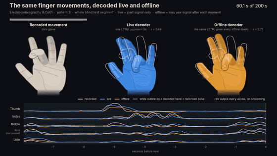
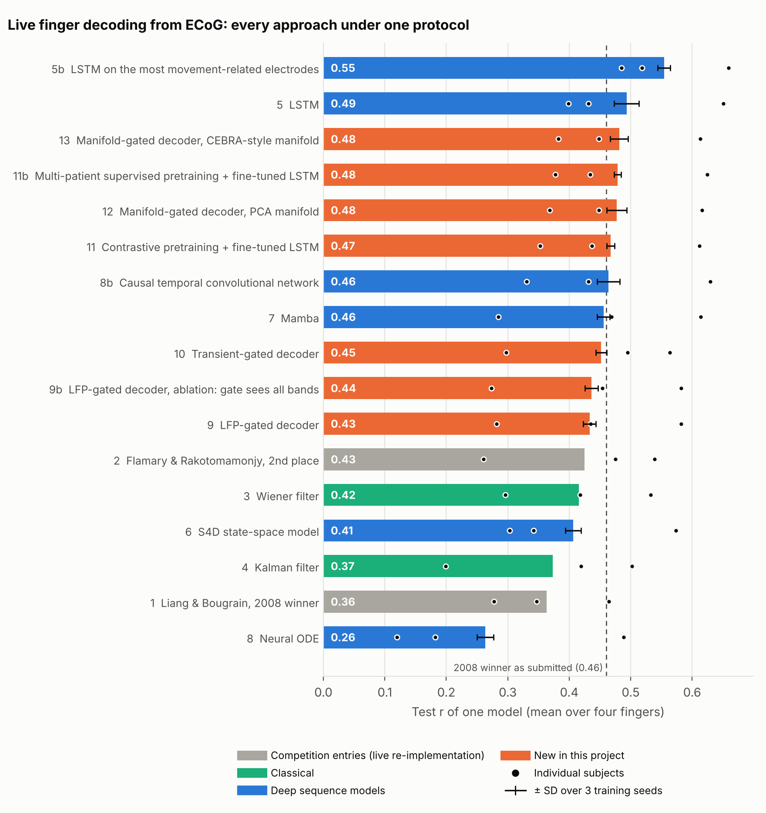
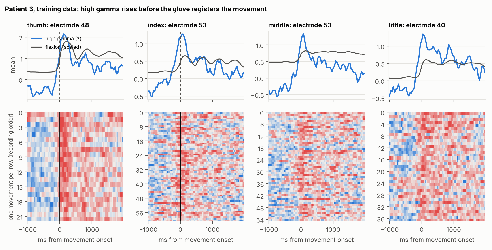
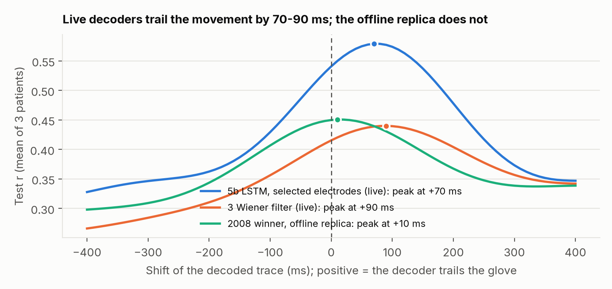
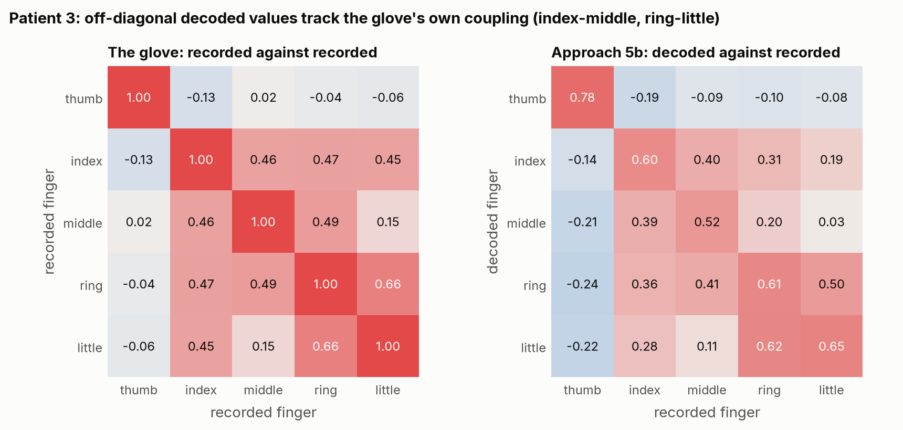
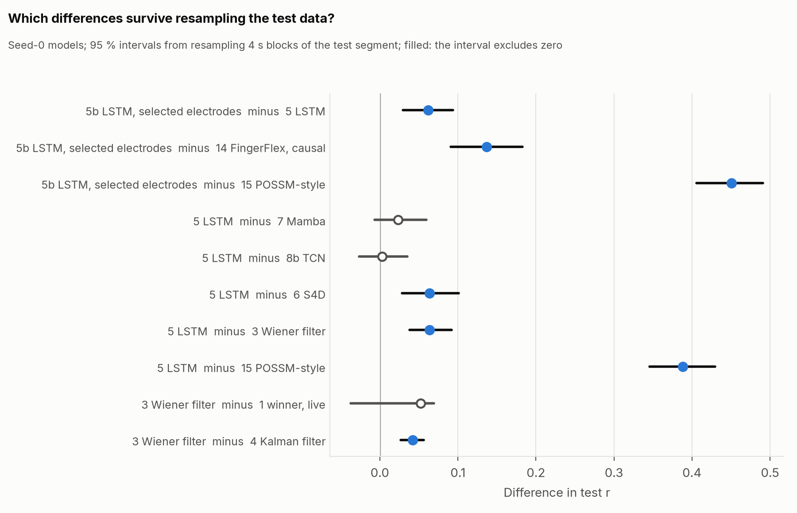
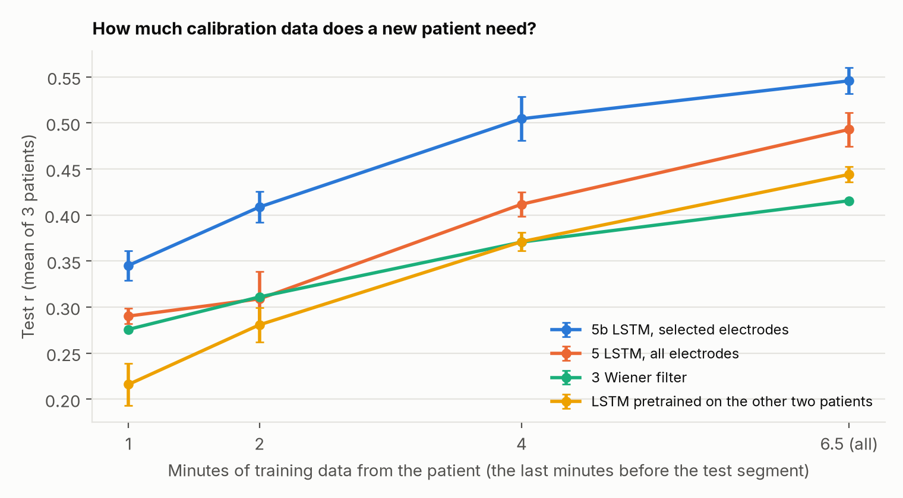
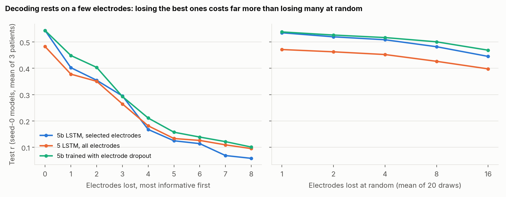

# Causal decoding of individual finger movements from human ECoG


*Blind test data from patient 3, replayed in real time (16 s here; the whole 200 s test segment in the
[MP4](https://github.com/AndreeaLuizaMarin/ecog-finger-decoding/releases/download/v0.1.0/hand_live_sub3.mp4)). Left:
high-gamma activity of the 24 electrodes most related to movement in the training data. Middle: the hand driven by
the data glove. Right: the hand driven by the best causal decoder (approach 5b, seed-0 model), with the recorded pose
as a white outline. Raw output every 40 ms, no smoothing.*



*The same 16 s, decoded live and offline. Left: the glove. Middle: approach 5b live, from past signal only (r = 0.64
for this patient). Right: the same LSTM given every offline liberty: it sees the whole recording, with zero-phase
features and centred smoothing (r = 0.71). Seed-0 models, raw output every 40 ms; the whole test segment in the
[MP4](https://github.com/AndreeaLuizaMarin/ecog-finger-decoding/releases/download/v0.1.0/lstm_live_vs_offline_sub3.mp4).*

Decoders of five-finger flexion from electrocorticography (ECoG), compared under one protocol that mirrors a live
system. Every decoder produces a new output every 40 ms from past signal only (a pseudo-online replay of recorded
data), every setting is chosen on validation data, every score is that of one model on a blind test set, and every
look at the test set is logged. Data: [BCI Competition IV, data set 4](https://www.bbci.de/competition/iv/), three
epilepsy patients with subdural grids (48-64 electrodes, 1 kHz) and about 6.5 minutes of training data each.

## What it shows

1. **The best causal decoder reaches r = 0.55 ± 0.01** (LSTM on the electrodes most related to movement; mean ± SD
   over three training seeds). Restricting the electrodes is the one change whose gain survives resampling the test
   data (+0.06, 95 % interval +0.03 to +0.09). The differences between the LSTM, Mamba and a causal TCN do not.
2. **Running live costs methods designed offline more than a method designed live.** The 2008 winner loses 0.09 and
   FingerFlex 0.20 when they have to be causal; the LSTM gains only 0.06 when it is given every offline
   liberty. FingerFlex, the best published result (0.67 reported), scores 0.63 retrained here as published, 0.60
   once its epoch is chosen on validation instead of the test set, and 0.39 ± 0.01 when made causal.
3. **Live decoders trail the hand**, the best one by 70 ms (60-180 ms across decoders): the delay of causal filters
   and trailing windows. Shifted back by that delay, it would score 0.58 instead of 0.54.
4. **Most of r comes from knowing which finger moves when.** The movement envelope is decoded at r = 0.62, the shape
   within a movement at 0.43. Decoded fingers leak into each other about as much as the recorded fingers move
   together (index with middle, ring with little).
5. **Choosing electrodes is worth more than more data.** With 4 of the 6.5 minutes, approach 5b already beats the
   LSTM on all electrodes trained on all of them (0.50 against 0.49), and no decoder levels off at 6.5 minutes.
   Pretraining on the other two patients does not help a new one: it scores below training from scratch at every
   amount of data.
6. **Decoding rests on a few electrodes.** Losing the best one costs approach 5b 0.14, losing 16 at random 0.10.
   Training with electrode dropout, rejected on validation, keeps the test score and loses 0.10 with the best
   electrode gone.

| # | Approach | S1 | S2 | S3 | **Test r** (one model; mean ± SD over seeds) |
|---|---|---|---|---|---|
| | *BCI Competition IV entries, re-implemented to run live* | | | | |
| 1 | Liang & Bougrain, 2008 winner (live re-implementation) | 0.46 | 0.28 | 0.35 | **0.36** |
| 2 | Flamary & Rakotomamonjy, 2nd place (live re-implementation) | 0.48 | 0.26 | 0.54 | **0.43** |
| | *Classical decoders* | | | | |
| 3 | Wiener filter (lagged ridge regression) | 0.42 | 0.30 | 0.53 | **0.42** |
| 4 | Kalman filter | 0.42 | 0.20 | 0.50 | **0.37** |
| | *Deep sequence models* | | | | |
| 5 | LSTM (256 units, dropout 0.4, augmentation; tuned on validation) | 0.43 | 0.40 | 0.65 | **0.49** ± 0.02 |
| 5b | **LSTM on the most movement-related electrodes** (number chosen per patient) | 0.52 | 0.49 | 0.66 | **0.55** ± 0.01 |
| 6 | S4D state-space model | 0.34 | 0.30 | 0.57 | **0.41** ± 0.01 |
| 7 | Mamba (selective state space) | 0.47 | 0.28 | 0.61 | **0.46** ± 0.01 |
| 8 | Neural ODE (continuous-time dynamics) | 0.18 | 0.12 | 0.49 | **0.26** ± 0.01 |
| 8b | Causal temporal convolutional network (TCN) | 0.43 | 0.33 | 0.63 | **0.46** ± 0.02 |
| 14 | FingerFlex (Lomtev et al., 2023), made causal | 0.36 | 0.31 | 0.51 | **0.39** ± 0.01 |
| | *New in this project* | | | | |
| 9 | LFP-gated decoder (gate: LMP, mu, beta) | 0.44 | 0.28 | 0.58 | **0.43** ± 0.01 |
| 9b | LFP-gated decoder, ablation: gate sees all bands | 0.45 | 0.27 | 0.58 | **0.44** ± 0.01 |
| 10 | Transient-gated decoder (Dekleva-inspired) | 0.50 | 0.30 | 0.56 | **0.45** ± 0.01 |
| 11 | Contrastive pretraining + fine-tuned LSTM | 0.44 | 0.35 | 0.61 | **0.47** ± 0.01 |
| 11b | Multi-patient supervised pretraining + fine-tuned LSTM | 0.43 | 0.38 | 0.62 | **0.48** ± 0.01 |
| 12 | Manifold-gated decoder, PCA manifold | 0.45 | 0.37 | 0.62 | **0.48** ± 0.02 |
| 13 | Manifold-gated decoder, CEBRA-style manifold | 0.45 | 0.38 | 0.61 | **0.48** ± 0.01 |
| 15 | POSSM-style electrode-token decoder (after Ryoo et al., 2025) | 0.03 | 0.08 | 0.18 | **0.09** ± 0.00 |

Approach 15 did not learn from 6.5 minutes of one patient; POSSM is built to be pretrained on many sessions.
Validation scores, run times and every setting: [METHODS.md](METHODS.md), sections 4 and 5.



## Live versus offline

The competition was run offline: entrants received the whole test recording. To measure what that freedom is worth,
the best entries and FingerFlex were rebuilt twice, as their papers and code describe (offline) and causally
([`offline.py`](src/ecogdecode/offline.py), [`fingerflex.py`](src/ecogdecode/fingerflex.py); every point a paper
leaves open is listed in the code with the choice made).

| Method | Designed for | Scored offline | Scored live | Cost of running live |
|---|---|---|---|---|
| Liang and Bougrain, 2008 winner | offline | 0.45 (replica; awarded 0.46) | 0.36 (approach 1) | -0.09 |
| FingerFlex (Lomtev et al., 2023) | offline | 0.60 (epoch chosen on validation; seed 0) | 0.39 ± 0.01 (approach 14) | -0.20 |
| LSTM on selected electrodes | live | 0.62 ± 0.01 (bidirectional, zero-phase) | 0.55 ± 0.01 (approach 5b) | -0.06 |

* **FingerFlex as published picks its epoch on the test set.** Its notebooks pass the test recording as the
  validation set and keep the checkpoint that scores best on it. Retrained here with that rule it scores 0.63 (seed
  0; 0.67 reported); with the epoch chosen on the last 20 % of the training data instead, 0.60.
* **The second place does not replicate from its paper** (0.33 against the 0.42 submitted): it relies on
  hand-segmented training data and unreported parameters. Its live redesign here scores 0.43.
* **What single liberties are worth** (measured on fixed models): zero-phase centred features +0.01, and +0.05 with
  future lags as well, for the Wiener filter; interpolating between outputs +0.02, and +0.03 with a centred smoother
  as well, for approach 5b; picking the stopping epoch on the test set +0.04.


*Patient 3, 16 s (whole segment in the
[MP4](https://github.com/AndreeaLuizaMarin/ecog-finger-decoding/releases/download/v0.1.0/live_vs_offline_sub3.mp4)).
Left: the glove. Middle: approach 5b, live. Right: the 2008 winner's method as published, offline, with every liberty
the competition allowed. r is for this patient.*

## What the decoders see, and what they get wrong



*Training data only. High-gamma power of the electrode most related to each finger, one row per movement in
recording order: it rises 100-200 ms before the glove registers the movement, movement after movement.*



*Test r against a shift of the decoded trace (mean of three patients): the live decoders peak 70-90 ms late, the
offline replica of the 2008 winner on time.*



*Patient 3: correlation of every decoded finger with every recorded finger, next to the glove's own coupling
between fingers.*



*Test-set uncertainty: the official score recomputed on 2,000 resamples of the 4 s test blocks (exact, from
per-block sums). The SD over training seeds in the table measures training randomness, not this.*

## How much data, and how robust



*Test r against minutes of the patient's own training data (the last D minutes before the test segment, so the gap
to the test stays the same; mean of three patients, ± SD over seeds). The LSTM pretrained on the other two
patients is fine-tuned on the same minutes.*



*Test r as electrodes fail for the whole test segment, the most informative first or at random (seed-0 models, mean
of three patients).*

## Use it

```python
import numpy as np
from ecogdecode import OnlineDecoder
from ecogdecode.synthetic import make_synthetic_subject

data = make_synthetic_subject()  # or your own: raw ECoG (samples x electrodes) and flexion at 1 kHz
decoder = OnlineDecoder.fit(data.train_ecog, data.train_flex, approach="lstm", n_electrodes=4)

decoder.reset()
for chunk in np.split(data.test_ecog, len(data.test_ecog) // 40):  # 40 new samples = 40 ms
    flexion = decoder.step(chunk)  # five finger values, from past signal only

decoder.use_onnx("decoder.onnx")  # the same steps through ONNX Runtime
```

`step` runs the whole live pipeline: median re-reference, notches, band power over trailing windows, z-scoring with
training statistics, the artefact rule, one network step, the causal smoother. Streaming a recording chunk by chunk
reproduces the batch prediction (tested), and one step takes 0.7-0.9 ms on one CPU thread.

## Reproduce

```bash
pip install torch --index-url https://download.pytorch.org/whl/cpu   # or your CUDA build
pip install -e ".[dev]"
pytest                                                    # 84 tests on synthetic data, no download needed

# data set 4 (Matlab) and true_labels.zip from https://www.bbci.de/competition/iv/ into data/, then:
python scripts/run_benchmark.py --data-dir data --streaming   # every approach; about 3.5 h on one core, plus FingerFlex
python scripts/summarise.py && python scripts/make_figures.py
python scripts/offline_study.py --data-dir data           # offline replicas and live-versus-offline analyses
python scripts/posthoc.py --data-dir data                 # bootstrap, lag, which finger, masking
python scripts/verify_scores.py --data-dir data           # recompute every stored score from the saved predictions
```

The other studies (validation search, calibration, electrode loss, offline LSTM) and their run times are listed in
[CLAUDE.md](CLAUDE.md). Use at most about six PyTorch threads per process: on hybrid CPUs the default of one thread
per logical core is several times slower.

## Protocol

* **Causal.** Forward-only filters, trailing windows, causal models; a test changes future samples and checks that no
  earlier output moves, for the features and every network.
* **Choices on validation only.** The last 20 % of each training segment (80 s) chooses every setting; the model is
  then refitted on the whole training segment and scored once on the test segment (the last 200 s).
* **One model per number.** Networks are trained with three seeds and scored one by one; outputs are never averaged.
* **Every test look is logged.** The test labels are read only to score; each script that reads them appends the git
  commit and its purpose to [`results/test_looks.jsonl`](results/test_looks.jsonl). The test set was consulted in
  eight rounds while the project grew ([METHODS.md](METHODS.md), section 10); choices within a round were made on
  validation, but repeated looks can still make the final numbers slightly optimistic.

## Limitations

* Three patients and 6.5 minutes of training data each; 200 s of test data per patient (6-19 flexions per finger).
* Pseudo-online, not closed-loop: no patient saw the decoder's output, so adaptation by the user is not captured.
* Electrode positions are not part of the data set, so the electrode maps are by index, not on the cortex.
* The validation-test gap (0.68 against 0.55 for 5b) points at drift within a session; online recalibration is the
  next step, and the larger [Stanford ECoG library](https://searchworks.stanford.edu/view/zk881ps0522) (Miller, 2019)
  would show whether cross-patient pretraining pays off with more patients.
* Retraining a network with the same seed on another machine changes its score slightly (approach 5b: 0.546 ± 0.014
  on the laptop that ran round 8, against 0.554 ± 0.010; [METHODS.md](METHODS.md), section 11).

## Data and references

Data: BCI Competition IV, data set 4, recorded by K. J. Miller and G. Schalk; not redistributed here. Use of the data
requires citing Schalk et al. (2007). To cite this repository, see [CITATION.cff](CITATION.cff).

* Schalk G, et al. (2007). Decoding two-dimensional movement trajectories using electrocorticographic signals in humans. *J Neural Eng* 4:264–275.
* Kubánek J, Miller KJ, Ojemann JG, Wolpaw JR, Schalk G (2009). Decoding flexion of individual fingers using electrocorticographic signals in humans. *J Neural Eng* 6:066001.
* Liang N, Bougrain L (2012). Decoding finger flexion from band-specific ECoG signals in humans. *Front Neurosci* 6:91.
* Flamary R, Rakotomamonjy A (2012). Decoding finger movements from ECoG signals using switching linear models. *Front Neurosci* 6:29.
* Lomtev V, Kovalev A, Timchenko A (2023). FingerFlex: inferring finger trajectories from ECoG signals. arXiv:2211.01960. Code: <https://github.com/Irautak/FingerFlex>.
* Ryoo AH, Krishna NH, Mao X, Azabou M, Dyer EL, Perich MG, Lajoie G (2025). Generalizable, real-time neural decoding with hybrid state-space models. *NeurIPS*. arXiv:2506.05320.
* Azabou M, et al. (2023). A unified, scalable framework for neural population decoding (POYO). *NeurIPS*.
* Wu W, Gao Y, Bienenstock E, Donoghue JP, Black MJ (2006). Bayesian population decoding of motor cortical activity using a Kalman filter. *Neural Comput* 18:80–118.
* Gu A, Gupta A, Goel K, Ré C (2022). On the parameterization and initialization of diagonal state space models. *NeurIPS*.
* Gu A, Dao T (2023). Mamba: linear-time sequence modeling with selective state spaces. arXiv:2312.00752.
* Bai S, Kolter JZ, Koltun V (2018). An empirical evaluation of generic convolutional and recurrent networks for sequence modeling. arXiv:1803.01271.
* Schneider S, Lee JH, Mathis MW (2023). Learnable latent embeddings for joint behavioural and neural analysis (CEBRA). *Nature* 617:360–368.
* Dekleva BM, Weiss JM, Boninger ML, Collinger JL (2021). Generalizable cursor click decoding using grasp-related neural transients. *J Neural Eng* 18:0460e9.
* Miller KJ (2019). A library of human electrocorticographic data and analyses. *Nat Hum Behav* 3:1225–1235.

---
Andreea Luiza Marin · MSc Neuroengineering (TUM) · MIT licence · methods, sources and development history in
[METHODS.md](METHODS.md)
