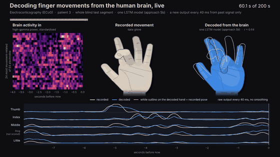
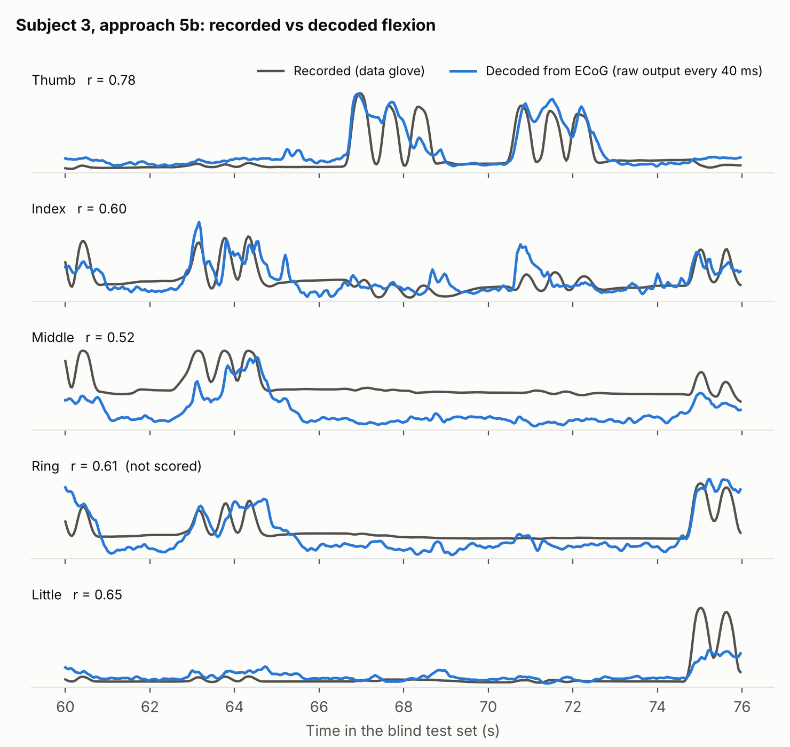
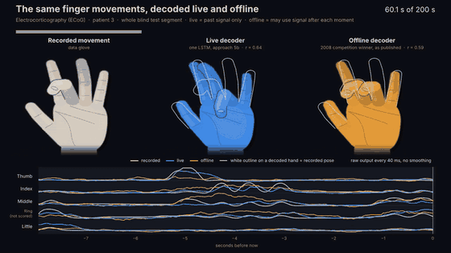
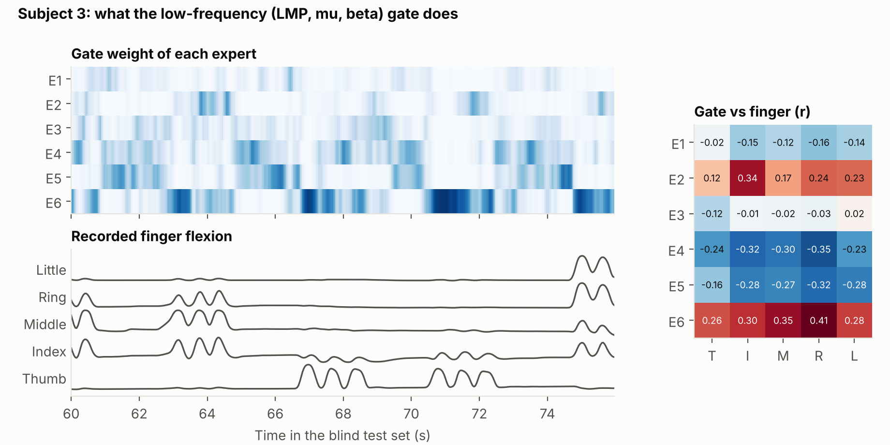

# Live decoding of individual finger movements from human ECoG



*Blind test data from patient 3, replayed in real time: a 16 s excerpt here, the whole 200 s test segment in the
[MP4](https://github.com/AndreeaLuizaMarin/ecog-finger-decoding/releases/download/v0.1.0/hand_live_sub3.mp4). Left: high-gamma activity of the 24 electrodes most related to movement in
the training data. Middle: the hand driven by the data glove. Right: the hand driven by one live decoder (approach 5b,
the LSTM on the most movement-related electrodes, seed-0 model), with the recorded pose as a white outline. Nothing is
smoothed: every panel shows the raw value every 40 ms. Each finger is drawn relative to its own resting level, because
the glove's resting reading drifts (for this patient the middle finger's rest level moves by about half its flexion
range over the test segment); scores are for the raw output against the raw glove.*

Seventeen ways to decode the flexion of all five fingers from electrocorticography (ECoG), compared under **one
protocol**: every decoder runs **live** (a new output every 40 ms, from past signal only), every setting is chosen
on **validation data**, and every score is that of **one model** on a **blind test set**. Outputs of several models
are never averaged. The approaches range from the two best entries of the original competition, re-implemented to
run live, through the Wiener and Kalman filters, LSTM, S4D, Mamba, a TCN and a neural ODE, to new decoders gated by
**brain state** or by the patient's position on a **neural manifold**, and **pretraining across patients**.

**Results in one line:** one LSTM that reads only the electrodes most related to movement, with every setting chosen
on validation data, decodes finger flexion live at **r = 0.55 ± 0.01** on the blind test set (mean ± SD over three
independently trained models). The 2008 winner submitted 0.46, and its method re-implemented to run live scores
0.36. Later published methods score 0.52–0.53 (as reported by Lomtev et al., 2023); none of those is reported as a
live, single-model result.

**Offline versus live:** the winner's method run as published, offline, scores 0.45 here (awarded: 0.46).
Each offline liberty (filters and windows that reach ahead, interpolation, smoothing centred on each moment, picking
the model on the test set) is worth a few hundredths; [Live versus offline](#live-versus-offline) measures them one
by one. Every method, choice and source is documented for independent review in [METHODS.md](METHODS.md).

Data: [BCI Competition IV, data set 4](https://www.bbci.de/competition/iv/). Three epilepsy patients with
subdural electrode grids (48–64 electrodes, 1 kHz) flexed individual fingers on cue while a data glove
recorded the movement. The first 2/3 of each recording is for training, the last 1/3 is the test set.

## Key findings

1. **Fewer electrodes, better decoding: r = 0.55.** Restricting the LSTM to the electrodes most related to movement
   raised the single-model test score from 0.49 to 0.55 ± 0.01, with a gain for every patient (S1 0.43 → 0.52,
   S2 0.40 → 0.49, S3 0.65 → 0.66). Electrodes are ranked on training data only, by the strongest correlation between
   any of their features and any finger; how many to keep (32 for patients 1 and 3, 8 for patient 2) was chosen on
   validation. With about 6.5 minutes of training data, an LSTM given all 48–64 electrodes also fits the noise of
   electrodes that carry little movement information.
2. **Tuning on validation lifts the all-electrode LSTM from 0.46 to 0.49.** A larger LSTM (256 units), stronger
   dropout (0.4) and data augmentation raised its single-model test score from 0.46 (previous version of this
   repository) to 0.49 ± 0.02. The augmentation shifts all features of each electrode by a random offset in every
   training window and adds feature noise, mimicking the slow gain and impedance changes of a chronic implant.
   Learning rate, weight decay, batch size, window length, finer frequency bands and time-warp augmentation brought
   no further gain ([validation study](#how-the-lstm-was-improved)).
3. **The largest loss happens between validation and test.** Approach 5 scores 0.57 on validation and 0.49 on test;
   approach 5b scores 0.68 and 0.55. Part of the gap is selection: every choice picked on the validation block
   flatters the validation score (for approach 5, a fixed schedule with no stopping epoch picked scores 0.54 instead
   of 0.57). The rest is most likely drift: the test segment was recorded after everything the decoder saw. Online
   re-normalisation, which follows slow drift without labels, did not help on validation (0.549 vs 0.554), so it
   was not used. For implants, adapting to drift over hours and days is the problem worth solving next.
4. **Every decoder here leans on its best electrodes.** Silencing the single most movement-related electrode for the
   whole test segment (seed-0 models; [`scripts/robustness.py`](scripts/robustness.py)) costs the all-electrode LSTM
   0.11 (0.48 → 0.37) and the selected-electrode LSTM 0.13 (0.54 → 0.41). Training with electrode dropout would buy
   robustness at a price in accuracy (validation 0.62 → 0.59–0.60), so it was not used for the headline; for an
   implant, that trade-off should be made on purpose. The live re-implementation of the 2008 winner shows the
   extreme case: it relies on about ten electrode–band pairs, one of its electrodes becomes artefactual only in the
   test segment (its amplitude features reach 3,886 training SDs; training maximum: 11), and its subject-3 score
   falls to 0.35 (published 0.59). Removing that electrode restored 0.63 in a post-hoc check. The masking rule keeps
   such artefacts out of every other decoder here, and that electrode is not among those approach 5b selects.
5. **The manifold-gated decoder comes within one SD of the all-electrode LSTM with half its recurrent units, but the
   gate itself adds no clear accuracy.** A gate reads the patient's current position on a low-dimensional neural
   manifold (PCA, or a CEBRA-style embedding trained contrastively with the finger kinematics as auxiliary variable)
   and decides which of six read-outs of a shared 128-unit LSTM to trust. It scores 0.48 ± 0.02 (PCA) and
   0.48 ± 0.01 (CEBRA-style) on test, against 0.49 ± 0.02 for the 256-unit LSTM. A matched control without the gate
   (same 128-unit LSTM and training) scores 0.543 on validation, against 0.550 (PCA gate) and 0.530 (CEBRA-style
   gate): a difference within seed noise. With leaky-integrator (neuromorphic-style) experts instead of the LSTM, the
   decoder is too weak here (0.41 on validation).
6. **Pretraining across patients gives the most consistent models, not the best ones.** Contrastive (0.47) and
   supervised multi-patient pretraining (0.48) have the smallest seed-to-seed spread of the all-electrode networks
   (SD 0.006) but do not beat the tuned LSTM. *Correction:* an earlier version of this README reported 0.53 for
   contrastive pretraining. That number came from averaging the outputs of three models, and its gain over the LSTM
   was within the seed-to-seed spread.
7. **A gate driven only by the slow, LFP-band rhythms works as well as one that sees everything** (0.43 vs 0.44).
   The gate learned by itself to switch between a *movement* and a *rest* mode, consistent with mu/beta
   desynchronisation at movement onset, while the high-gamma experts carry finger identity. Adding onset/offset
   transients to the gate (approach 10) gives the best subject-1 score among the all-electrode decoders (0.50).
8. **Newer is not automatically better on small data.** Mamba (0.46), the TCN (0.46) and S4D (0.41) stay below the
   LSTM on the same inputs (0.49), and the neural ODE (0.26) underfits.
9. **A Kalman filter is not automatically the better live decoder.** Every decoder here is live. The Kalman filter is
   the optimal live estimator only if the features are a linear function of the finger state and the fingers follow
   linear dynamics with Gaussian noise; ECoG band power rises with any movement, and fingers rest, then flex in
   bursts. On validation, the classical filter (0.35 with 64 principal components), a version that also observes the
   previous feature vectors (0.35) and a discriminative Kalman filter on top of the Wiener filter (0.33) all stay
   below the Wiener filter alone (0.42) ([METHODS.md](METHODS.md), section 6). Kalman filters excel with
   intracortical spikes, which track intended velocity almost linearly, in closed-loop use.
10. **Live is cheap.** Turning 40 ms of raw ECoG into a decoded output takes 0.7–0.9 ms on one CPU thread, and the
   live output matches the offline one to within floating-point rounding.

## Results

Pearson r between decoded and recorded flexion on the blind test set: the official competition metric, at 1 kHz,
averaged over thumb, index, middle and little finger (the ring finger is excluded, as in the competition).
*Validation r* is what every choice was based on. S1–S3 and *Test r* are scores of single models: networks were
trained with 3 seeds, each model was scored on its own, and the table gives the mean (± the SD over seeds of the
three-subject score). The closed-form decoders (1–4) are deterministic. *Live step*: median time to turn 40 ms of raw
ECoG into a decoded output (features + ONNX model, one CPU thread of a cloud VM), measured while replaying the whole
recording; approach 5b is approach 5 on a subset of the same feature columns, so it runs no slower.

| # | Approach | Validation r | S1 | S2 | S3 | **Test r** (one model; mean ± SD over seeds) | Live step |
|---|---|---|---|---|---|---|---|
| | *BCI Competition IV entries, re-implemented to run live* | | | | | | |
| 1 | Liang & Bougrain, 2008 winner (live re-implementation) | 0.49 | 0.46 | 0.28 | 0.35 | **0.36** | – |
| 2 | Flamary & Rakotomamonjy, 2nd place (live re-implementation) | 0.45 | 0.48 | 0.26 | 0.54 | **0.43** | – |
| | *Classical decoders* | | | | | | |
| 3 | Wiener filter (lagged ridge regression) | 0.42 | 0.42 | 0.30 | 0.53 | **0.42** | – |
| 4 | Kalman filter | 0.37 | 0.42 | 0.20 | 0.50 | **0.37** | – |
| | *Deep sequence models* | | | | | | |
| 5 | LSTM (256 units, dropout 0.4, augmentation; tuned on validation) | 0.57 | 0.43 | 0.40 | 0.65 | **0.49** ± 0.02 | 0.90 ms |
| 5b | **LSTM on the most movement-related electrodes** (number chosen per patient) | 0.68 | 0.52 | 0.49 | 0.66 | **0.55** ± 0.01 | – |
| 6 | S4D state-space model | 0.40 | 0.34 | 0.30 | 0.57 | **0.41** ± 0.01 | 0.87 ms |
| 7 | Mamba (selective state space) | 0.44 | 0.47 | 0.28 | 0.61 | **0.46** ± 0.01 | – |
| 8 | Neural ODE (continuous-time dynamics) | 0.34 | 0.18 | 0.12 | 0.49 | **0.26** ± 0.01 | – |
| 8b | Causal temporal convolutional network (TCN) | 0.47 | 0.43 | 0.33 | 0.63 | **0.46** ± 0.02 | – |
| | *New in this project* | | | | | | |
| 9 | LFP-gated decoder (gate: LMP, mu, beta) | 0.44 | 0.44 | 0.28 | 0.58 | **0.43** ± 0.01 | 0.72 ms |
| 9b | LFP-gated decoder, ablation: gate sees all bands | 0.42 | 0.45 | 0.27 | 0.58 | **0.44** ± 0.01 | – |
| 10 | Transient-gated decoder (Dekleva-inspired) | 0.48 | 0.50 | 0.30 | 0.56 | **0.45** ± 0.01 | – |
| 11 | Contrastive pretraining + fine-tuned LSTM | 0.46 | 0.44 | 0.35 | 0.61 | **0.47** ± 0.01 | – |
| 11b | Multi-patient supervised pretraining + fine-tuned LSTM | 0.49 | 0.43 | 0.38 | 0.62 | **0.48** ± 0.01 | – |
| 12 | Manifold-gated decoder, PCA manifold | 0.56 | 0.45 | 0.37 | 0.62 | **0.48** ± 0.02 | – |
| 13 | Manifold-gated decoder, CEBRA-style manifold | 0.53 | 0.45 | 0.38 | 0.61 | **0.48** ± 0.01 | – |




*Subject 3, seconds 60–76 of the test set (chosen because all five fingers move in that window); approach 5b,
seed-0 model. Raw glove and raw decoder output (one value every 40 ms, no smoothing).*

### Comparison with published results

| Method | Live? | Blind test? | One model? | r |
|---|---|---|---|---|
| Liang & Bougrain, competition winner (2008 submission) | no (each feature sums the 40 ms *after* its moment) | yes | yes | 0.46 |
| Flamary & Rakotomamonjy, 2nd place | no (uses future samples) | yes | yes | 0.42 |
| LSTM (Xie et al., 2018); LightGBM (Yao et al., 2022), as reported by Lomtev et al. | – | – | – | 0.52; 0.53 |
| FingerFlex, convolutional encoder–decoder (Lomtev et al., 2023) | no (window includes the future; centred smoothing) | no (checkpoint picked on the test set, per its code) | yes | 0.67 |
| **This repository: LSTM on selected electrodes (approach 5b)** | **yes** | **yes** | **yes** | **0.55 ± 0.01** |
| This repository: LSTM on all electrodes (approach 5) | yes | yes | yes | 0.49 ± 0.02 |

The question this repository asks is how much decoding accuracy survives when every decoder has to run live and
every choice is made without the test labels. The next section measures it.

## Live versus offline



*Patient 3: a 16 s excerpt here, the whole 200 s test segment in the [MP4](https://github.com/AndreeaLuizaMarin/ecog-finger-decoding/releases/download/v0.1.0/live_vs_offline_sub3.mp4).
Left: the glove. Middle: approach 5b, live (past signal only). Right: the 2008 winner's method run as published,
offline. Nothing is smoothed; each trace is drawn relative to its own resting level (as above); r is for
this patient.*

The competition was run offline: entrants received the whole test recording and returned predictions for all of it.
To see what that freedom is worth, the two best entries were rebuilt **as their papers describe**, including
the steps that look ahead ([`src/ecogdecode/offline.py`](src/ecogdecode/offline.py); every point a paper leaves open
is listed in the code with the choice made), and compared with live versions. Full account with sources:
[METHODS.md](METHODS.md), section 7.

| Method | As published | Offline replica here | Same method, filters simply run forward | Live redesign here |
|---|---|---|---|---|
| Liang & Bougrain (winner) | 0.46 | **0.45** (0.44 / 0.31 / 0.59) | 0.31 | 0.36 (approach 1) |
| Flamary & Rakotomamonjy (2nd) | 0.42 | 0.33 (0.41 / 0.28 / 0.32) | – | 0.43 (approach 2) |

* **The winner replicates.** Run offline as published, it scores 0.45 against the 0.46 it was awarded; an independent
  reproduction ([ecog-diagnostic-benchmark](https://github.com/longkey-szpt/ecog-diagnostic-benchmark)) reaches 0.46.
* **Its filters cannot simply be run forward.** Its long FIR filters, applied forward only, delay the 1–60 Hz band by
  1.65 s and score 0.31. A live system needs filters designed for it (approach 1 uses short Butterworth filters).
* **The second place does not fully replicate from its paper**: it relies on hand-segmented training data and on
  parameter values the paper does not report. This replica reaches 0.33 and the independent one 0.23; the live
  redesign here, with validated choices, scores 0.43. On patient 3 the replica is pulled down by the same faulty
  electrode (below): without it, a post-hoc check gives 0.52 (submitted: 0.55).
* **Why the live winner fails on patient 3:** electrode 49 carries a burst of artefact about 130–150 s into the test
  segment. Whether the greedy search picks that electrode decides the score: the replica as published (no intercept)
  does not pick it and scores 0.59; the same replica with an intercept, and the live version, do pick it and lose the
  middle finger (r ≈ 0.04–0.06).

What the offline liberties are worth for one fixed model (each measured on the blind test set; nothing here fed back
into any live decoder):

| Offline liberty | Live | Offline | Gain |
|---|---|---|---|
| Wiener filter: zero-phase features centred on each moment | 0.403 | 0.417 | +0.01 |
| Wiener filter: the same plus 400 ms of future feature lags | 0.403 | 0.449 | +0.05 |
| Approach 5b: predictions interpolated between steps instead of held (uses the next output) | 0.541 | 0.560 | +0.02 |
| Approach 5b: plus a centred Gaussian smoother (60 ms, as FingerFlex uses) | 0.541 | 0.570 | +0.03 |
| Approach 5b: stopping epoch picked on the test set instead of validation (step-level r) | 0.572 | 0.614 | +0.04 |

Each liberty is worth a few hundredths; together they are of the same order as the gap between the best live decoder
here (0.55) and the best published offline result (0.67). FingerFlex itself was not retrained (it needs a GPU; see
METHODS.md, section 9), so that comparison is indicative, not measured.

### How the LSTM was improved

Validation-only study ([`scripts/explore_validation.py`](scripts/explore_validation.py), which never loads the test
labels). Each configuration was trained on the first 80 % of the training segment with 3 seeds and scored on the
validation block (the last 20 %); the test labels stay unread.

**Round 4: network and training.** A one-seed screen came first: a correlation loss, simulated electrode dropout and
finer high-gamma bands all scored below the plain LSTM, so they were dropped.

| Configuration | Validation r | S1 | S2 | S3 |
|---|---|---|---|---|
| LSTM 256/0.4, + stronger gain jitter and feature noise (0.5) | 0.572 | 0.52 | 0.45 | 0.74 |
| **LSTM 256/0.4, + gain jitter and feature noise (chosen: approach 5)** | 0.567 | 0.54 | 0.43 | 0.73 |
| LSTM, 256 units, dropout 0.4 | 0.554 | 0.54 | 0.44 | 0.68 |
| Manifold-gated, PCA manifold, 128-unit LSTM, dropout 0.4 + augmentation (approach 12) | 0.550 | 0.56 | 0.37 | 0.72 |
| LSTM 256/0.4, + online re-normalisation (180 s) | 0.549 | 0.55 | 0.38 | 0.71 |
| LSTM, 384 units, dropout 0.4 | 0.544 | 0.55 | 0.35 | 0.73 |
| LSTM 128/0.4, + gain jitter and feature noise (no gate: control for approaches 12–13) | 0.543 | 0.54 | 0.36 | 0.73 |
| LSTM 256/0.4 + augmentation, cosine schedule, 40 epochs, no early stopping | 0.538 | 0.51 | 0.38 | 0.73 |
| LSTM, 256 units | 0.534 | 0.53 | 0.35 | 0.72 |
| Manifold-gated, CEBRA-style manifold, 128-unit LSTM, dropout 0.4 + augmentation (approach 13) | 0.530 | 0.53 | 0.36 | 0.70 |
| LSTM 256/0.4, 200 ms feature window | 0.528 | 0.53 | 0.36 | 0.68 |
| LSTM, input dropout 0.4 | 0.526 | 0.50 | 0.37 | 0.70 |
| LSTM 256/0.4, cosine schedule, 80 epochs, no early stopping | 0.519 | 0.49 | 0.38 | 0.69 |
| LSTM, 128 units (previous version) | 0.516 | 0.49 | 0.37 | 0.69 |
| LSTM, + weight averaging (EMA) | 0.513 | 0.47 | 0.37 | 0.69 |
| Manifold-gated, CEBRA-style manifold, 128-unit LSTM | 0.498 | 0.48 | 0.34 | 0.67 |
| LSTM, two layers | 0.494 | 0.48 | 0.35 | 0.65 |
| Supervised multi-patient pretraining + LSTM | 0.488 | 0.42 | 0.36 | 0.69 |
| Manifold-gated, PCA manifold, 128-unit LSTM | 0.487 | 0.45 | 0.36 | 0.65 |
| Contrastive cross-patient pretraining + LSTM | 0.477 | 0.46 | 0.35 | 0.62 |
| Causal TCN | 0.471 | 0.47 | 0.29 | 0.65 |
| LSTM, 64 units | 0.460 | 0.43 | 0.28 | 0.66 |
| Manifold-gated, PCA manifold, leaky-integrator experts | 0.406 | 0.41 | 0.23 | 0.58 |

The stronger augmentation (0.5) scored 0.005 higher than 0.3. That difference is within seed noise, and the
stronger setting had twice the seed-to-seed spread, so the milder one was kept. Rows with early stopping pick their
stopping epoch on this same block and are therefore slightly flattered compared with the fixed-schedule rows.

**Round 5: settings of approach 5, then electrode selection.** Each row changes one thing in approach 5 (0.567 on
this block). Electrodes are ranked on the fit rows only; on refit they are ranked again on the whole training
segment.

| Configuration | Validation r | S1 | S2 | S3 |
|---|---|---|---|---|
| Approach 5, 8 electrodes, + time warp | 0.667 | 0.53 | 0.71 | 0.76 |
| Approach 5, 8 most movement-related electrodes only | 0.664 | 0.54 | **0.69** | 0.76 |
| Approach 5, 4 most movement-related electrodes only | 0.635 | 0.59 | 0.59 | 0.73 |
| Approach 5, 24 most movement-related electrodes only | 0.622 | 0.59 | 0.55 | 0.73 |
| Approach 5, 16 most movement-related electrodes only | 0.622 | 0.60 | 0.54 | 0.73 |
| Approach 5, 32 most movement-related electrodes only | 0.618 | **0.62** | 0.46 | **0.77** |
| Approach 5, 32 electrodes, + time warp | 0.612 | 0.57 | 0.51 | 0.76 |
| Approach 5, 16 electrodes, + electrode dropout 0.1 | 0.602 | 0.56 | 0.54 | 0.71 |
| Approach 5, 32 electrodes, + electrode dropout 0.1 | 0.591 | 0.55 | 0.49 | 0.74 |
| Approach 5, 48 most movement-related electrodes only | 0.580 | 0.57 | 0.41 | 0.76 |
| Approach 5, + time-warp augmentation (±20 % speed) | 0.578 | 0.55 | 0.43 | 0.75 |
| Approach 5, twice the steps per epoch | 0.572 | 0.57 | 0.40 | 0.75 |
| Approach 5, weight decay 0.1 | 0.564 | 0.56 | 0.39 | 0.74 |
| Approach 5, learning rate 2e-3 | 0.554 | 0.53 | 0.38 | 0.75 |
| Approach 5, dropout 0.5 | 0.554 | 0.54 | 0.39 | 0.74 |
| Approach 5, learning rate 5e-4 (up to 120 epochs) | 0.548 | 0.55 | 0.38 | 0.72 |
| Approach 5, batch 32 | 0.537 | 0.54 | 0.35 | 0.72 |
| Approach 5, finer high-gamma bands | 0.531 | 0.52 | 0.36 | 0.72 |
| Approach 5, 20 s training windows | 0.520 | 0.49 | 0.34 | 0.74 |

Approach 5b keeps, for each patient, the number of electrodes with the best validation score (bold): 32, 8 and 32.
The patients differ too much for one number to fit all (patient 2 loses 0.23 going from 8 to 32 electrodes; patient
1 gains 0.08). Picking the best of seven options per patient flatters the validation score, which is one reason
approach 5b falls from 0.68 on validation to 0.55 on test. Time warp helped with 8 electrodes and hurt with 32, so
it was left out.

## The approaches

| # | Approach | Idea |
|---|---|---|
| 1 | **Liang & Bougrain** (2008 winner) | Amplitude modulation (mean squared signal per 40 ms) in 1–60, 60–100 and 100–200 Hz for every electrode; 1 s of history; one least-squares (pseudo-inverse) model per finger; greedy forward selection of up to 10 electrode–band pairs on a 3/5–2/5 split. Live version: causal Butterworth filters. |
| 2 | **Flamary & Rakotomamonjy** (2nd place) | A classifier decides which of six states holds (rest or finger *k* moving); each state has its own ridge model from the local motor potential at three delays; the output is the model of the predicted state. Live version: causal delays only; the state classifier reads band power, because the original autoregressive features, made causal, gave chance-level states on validation. Validation chose a 120–320 ms output smoother, which removes the jumps between state models. |
| 3 | **Wiener filter** | Ridge regression on the current and previous feature vectors (history up to 1 s, chosen on validation). |
| 4 | **Kalman filter** | Finger position and velocity as a hidden state with linear dynamics; principal components of the features as noisy observations (Wu et al., 2006). |
| 5 | **LSTM** | Recurrent network over the feature stream; 256 units, input dropout 0.4, trained with electrode-gain and noise augmentation (all chosen on validation). |
| 5b | **LSTM on selected electrodes** | Approach 5, fed only by the electrodes most related to movement in the training data: each electrode is ranked by the strongest correlation between any of its features and any finger, and the number kept per patient (32, 8, 32) was chosen on validation. |
| 6 | **S4D** | Diagonal structured state-space model (Gu et al., 2022): long memory, trained as a convolution, run as a recurrence. |
| 7 | **Mamba** | Selective state space (Gu and Dao, 2023): the input decides, step by step, what the state keeps. Pure-PyTorch implementation with an exact chunked scan (tested against the step-by-step recurrence). |
| 8 | **Neural ODE** | Latent dynamics dh/dt = −h/τ + tanh(W[h, u]) driven by the features, integrated with Runge–Kutta (RK4) once per 40 ms. |
| 8b | **TCN** | Causal dilated convolutions (dilations 1–16, 2.5 s receptive field), normalised per time step so no statistic mixes past and future. |
| 9 | **LFP-gated decoder (new)** | A *gate* reads only the slow, LFP-like part of the ECoG (local motor potential, mu and beta power) and decides, at every step, which of six *experts* to trust. The experts read high-gamma power through leaky integrators, the membrane equation of neuromorphic neurons. 9b is an ablation whose gate sees every band. |
| 10 | **Transient-gated decoder (new)** | As 9, but the gate also sees movement onset and offset transients (the step-to-step change of high-gamma activity), inspired by Dekleva et al. (2021), who found grasp-onset transients larger and more reliable than the sustained response. Inputs are compressed with PCA fitted on training data. |
| 11 | **Contrastive pretraining (new)** | A shared recurrent core is first trained *without labels* on all three patients: neural states 40–200 ms apart should embed close together, states far apart should not (InfoNCE, in the spirit of CEBRA). Each patient has their own input layer. The core is then fine-tuned per patient. |
| 11b | **Multi-patient pretraining (new)** | As 11, but the shared core is pretrained *with* labels on all three patients, each with their own input and output layers. |
| 12 | **Manifold-gated decoder, PCA (new)** | The features are projected onto an 8-dimensional manifold (PCA fitted on training data). A gate integrates the manifold trajectory over time and weights six linear read-outs of a shared 128-unit LSTM (input dropout 0.4, trained with the same augmentation as approach 5). |
| 13 | **Manifold-gated decoder, CEBRA-style (new)** | As 12, but the manifold is learned: a causal encoder is trained contrastively so that moments with similar finger kinematics embed close together (CEBRA-behaviour, Schneider et al., 2023). The manifold is fitted on training data and frozen before the decoder is trained. |

Approaches 9, 10, 12 and 13 are learned, soft versions of the second-place entry's idea: switch between decoding
regimes (rest, or one finger or another moving) depending on the current state. Flamary and Rakotomamonjy switch
between linear models with a separate classifier; here a gate weights several read-outs at every step and is trained
with them. The question is whether the slow components of ECoG (9, 10), or the position on a neural manifold
(12, 13), can tell a decoder *which regime* it is in. The gate is fully inspectable:



## Protocol

* **Everything causal.** Features use forward-only filters and trailing 100 ms windows; decoders are causal.
  Both are unit-tested (changing the future never changes the past).
* **Chronological split.** First 2/3 of each recording: training, of which the last 20 % is the validation block.
  Last 1/3: the official test set.
* **Choices on validation only.** Feature window (100 ms beat 200 and 300 ms), ridge penalties and history, Kalman
  dimensionality, electrode selection (the winner's greedy search; how many electrodes approach 5b keeps), network
  size, dropout and augmentation, stopping epoch, and the time constant of an optional causal output smoother
  (0–320 ms) for every approach.
* **Refit.** After selection, each model is retrained on the whole training segment (for networks: from the same
  initial weights, for the chosen number of epochs).
* **One model, no averaging.** Networks are trained with 3 seeds; each seed's model is scored on its own and the
  mean ± SD is reported. Figures and the animation show the seed-0 model, fixed in advance.
* **Robust to bad electrodes, online.** Signals are re-referenced to the median across electrodes, and any
  electrode whose features jump beyond 6 SD of their training range is masked for that step.
* **Robustness.** After the final run, the seed-0 LSTMs (5 and 5b) were scored once more with their most important
  electrode silenced for the whole test segment ([finding 4](#key-findings)); nothing in that check fed back into
  any choice.
* **Live replay.** For approaches 5, 6 and 9 the trained model is exported to ONNX and the whole recording is
  replayed online (raw ECoG in 40-sample chunks → streaming features → ONNX decoder); the live output matches
  the offline output to within floating-point rounding.

### Development history (disclosure)

The test set was consulted in several rounds while this repository was developed:
1. A first benchmark (common-average reference, early-stopped models) showed that one electrode in subject 3 carries a
   burst of artefact about 130–150 s into the test segment (its SD over the test segment is 253 times its training
   SD; it is normal throughout training), which collapsed every decoder for that patient (r ≈ 0.1). Median
   re-referencing and the masking rule above were added; the 6 SD threshold was set once, not tuned.
2. A second round added refitting, seed averaging, a validation-selected ensemble and approach 10.
3. A third round reviewed and refactored the code, added the two competition entries and reran every approach.
4. A fourth round dropped all averaging of model outputs and reports single models only. Every change in it
   (approaches 8b, 11b, 12, 13, the LSTM tuning, the output smoother) was decided in the validation-only study above;
   the test set was then opened once, for all sixteen approaches then in the table.
5. A fifth round (round 5 of the validation study) tuned the settings of approach 5 and added electrode selection,
   again on validation only. The test set was then opened once more, for the one new approach (5b); the other
   sixteen rows are unchanged from round 4.
6. A sixth round added the Kalman variants (validation only; none was adopted, so the test set was not opened for
   them) and the live-versus-offline study. That study opens the test set for published methods run as published and
   for analyses that feed nothing back into any live decoder. The second-place replica was revised once after its first test result
   (0.22, then 0.33; see METHODS.md, section 10).

Every choice inside each round was made on validation data, but repeated looks at the same test set across rounds
can still make the final numbers slightly optimistic.

## Reproduce

```bash
pip install torch --index-url https://download.pytorch.org/whl/cpu   # or your CUDA build
pip install -e ".[dev]"
pytest                                      # 67 tests on synthetic data, no download needed

# download data set 4 (Matlab) and true_labels.zip from https://www.bbci.de/competition/iv/
# into data/ (zips or extracted folders both work), then:
python scripts/explore_validation.py --data-dir data --seeds 0 1 2   # optional: the validation study
python scripts/run_benchmark.py --data-dir data --streaming          # about 3.5 h on one core; approaches can run in parallel
python scripts/summarise.py                                          # results/summary.md and metrics.json
python scripts/robustness.py --data-dir data                          # optional: one electrode lost
python scripts/kalman_study.py --data-dir data                        # Kalman variants, validation only
python scripts/offline_study.py --data-dir data                       # offline replicas and live-vs-offline analyses
python scripts/make_figures.py
python scripts/make_animation.py --data-dir data                     # whole test segment, about 6 min on 2 cores
python scripts/make_offline_animation.py                              # recorded vs live vs offline
python scripts/report_tables.py                                       # every table of METHODS.md from the JSON files
```

```
src/ecogdecode/
  config.py       all settings: features, training, protocol
  data.py         loading, competition split
  features.py     causal (or, for the offline study, zero-phase) features, median re-referencing, artefact masking
  pipeline.py     chronological split, standardisation (optionally adaptive), electrode selection, scoring
  approaches.py   registry of every approach behind one interface
  models/         contest.py (entries 1-2), linear.py, kalman.py, recurrent.py (LSTM, neural ODE),
                  ssm.py (S4D, Mamba), conv.py (TCN), gated.py (LFP- and transient-gated),
                  manifold.py (PCA and CEBRA-style manifolds, manifold-gated decoder), training.py
  pretrain.py     contrastive and supervised pretraining across subjects
  streaming.py    online feature extraction, ONNX export and live replay
  evaluation.py   competition metric, causal output smoothing
  offline.py      the two best competition entries as published (offline), for comparison only
  handviz.py      the 3-D hand, display scaling and layout used by the videos
  render.py       renders a video in parallel chunks; GIF excerpts
scripts/          explore_validation, run_benchmark, summarise, robustness, kalman_study, offline_study,
                  report_tables, make_figures, make_animation, make_offline_animation, select_features
tests/            causality, streaming = offline, exact scans, contest models, offline replicas, every approach end to end
```

## Limitations and next steps

* Three patients and about 6.5 minutes of training data each: differences of a few hundredths of r are within
  seed-to-seed variability. The larger [Stanford ECoG library](https://searchworks.stanford.edu/view/zk881ps0522)
  (Miller, 2019) would settle them.
* The gap between validation (0.68) and test (0.55) points partly at drift within a single session. Unsupervised
  recalibration, or pretraining on many hours of unlabelled ECoG followed by per-patient fine-tuning, are the next
  steps.
* The gated decoders are neuromorphic *in spirit* (leaky integrators, multiplicative gating, 25 Hz updates); a
  spiking implementation on neuromorphic hardware is future work.
* LFADS-style latent-dynamics models were left out: they infer each moment from the whole trial, past and future,
  so they cannot run live as they are.
* FingerFlex was not retrained here (it needs a GPU). Retraining it with the checkpoint chosen on a validation block
  instead of the test set, and with causal convolutions, would measure directly how much of its 0.67 survives live.

## Data and references

Data: BCI Competition IV, data set 4, recorded by K. J. Miller and G. Schalk. Not redistributed here. Use of the
data requires citing Schalk et al. (2007).

* Schalk G, et al. (2007). Decoding two-dimensional movement trajectories using electrocorticographic signals in humans. *J Neural Eng* 4:264–275.
* Kubánek J, Miller KJ, Ojemann JG, Wolpaw JR, Schalk G (2009). Decoding flexion of individual fingers using electrocorticographic signals in humans. *J Neural Eng* 6:066001.
* Liang N, Bougrain L (2012). Decoding finger flexion from band-specific ECoG signals in humans. *Front Neurosci* 6:91.
* Flamary R, Rakotomamonjy A (2012). Decoding finger movements from ECoG signals using switching linear models. *Front Neurosci* 6:29.
* Lomtev V, Kovalev A, Timchenko A (2023). FingerFlex: inferring finger trajectories from ECoG signals. arXiv:2211.01960. Code: <https://github.com/Irautak/FingerFlex>.
* Independent reproductions of the winner, the second place and FingerFlex: <https://github.com/longkey-szpt/ecog-diagnostic-benchmark>.
* Gilja V, et al. (2012). A high-performance neural prosthesis enabled by control algorithm design. *Nat Neurosci* 15:1752–1757.
* Burkhart MC, Brandman DM, Franco B, Hochberg LR, Harrison MT (2020). The discriminative Kalman filter for Bayesian filtering with nonlinear and nongaussian observation models. *Neural Comput* 32:969–1017.
* Wu W, Gao Y, Bienenstock E, Donoghue JP, Black MJ (2006). Bayesian population decoding of motor cortical activity using a Kalman filter. *Neural Comput* 18:80–118.
* Gu A, Gupta A, Goel K, Ré C (2022). On the parameterization and initialization of diagonal state space models. *NeurIPS*.
* Gu A, Dao T (2023). Mamba: linear-time sequence modeling with selective state spaces. arXiv:2312.00752.
* Bai S, Kolter JZ, Koltun V (2018). An empirical evaluation of generic convolutional and recurrent networks for sequence modeling. arXiv:1803.01271.
* Schneider S, Lee JH, Mathis MW (2023). Learnable latent embeddings for joint behavioural and neural analysis (CEBRA). *Nature* 617:360–368.
* Dekleva BM, Weiss JM, Boninger ML, Collinger JL (2021). Generalizable cursor click decoding using grasp-related neural transients. *J Neural Eng* 18:0460e9.
* Miller KJ (2019). A library of human electrocorticographic data and analyses. *Nat Hum Behav* 3:1225–1235.

---
Andreea Luiza Marin · neuroengineer (MSc Neuroengineering, TUM) · MIT licence
